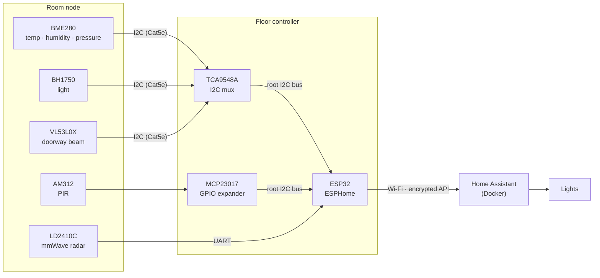
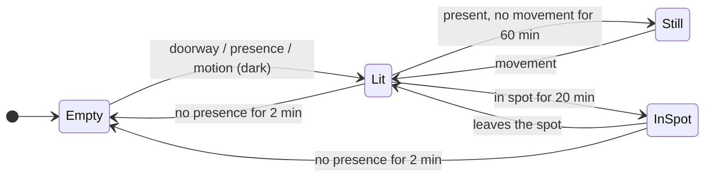

# Distributed Sensor and Automation System

A whole-home sensor network built on ESP32, ESPHome and a self-hosted Home Assistant.

Every room measures temperature, humidity, air pressure and light level, and detects people with an mmWave radar and a PIR. Every doorway has a laser beam. Rooms are wired back over Cat5e to **one ESP32 controller per floor**, which reports over Wi-Fi to Home Assistant running in Docker. Home Assistant runs the lighting: lights follow people from room to room, switch off when a room empties or when people have been still for an hour, and switch off when someone has settled into a particular spot (the sofa, the bed) for a set time.

## Features

- **Room climate and light.** BME280 (temperature, humidity, pressure) and BH1750 (lux) in every room.
- **Presence that sees still people.** A 24 GHz mmWave radar keeps detecting someone who is reading or watching TV, where a PIR alone would give up.
- **Doorway laser beams.** A VL53L0X time-of-flight sensor across each door frame switches lights on the moment someone steps into a dark room, before the radar has even confirmed them.
- **Spot detection.** The radar reports how far away a person is. A "spot" is a distance band (for example, 150–250 cm is the sofa), adjustable live from Home Assistant.
- **I2C over Cat5e.** Each room is its own cable run onto its own channel of a TCA9548A multiplexer. Each I2C signal is twisted with its own ground, and a second Cat5e run to each room is a spare.
- **Fused 12 V distribution.** A DIN-rail PSU feeds bus bars and one fused terminal per run; each room regulates down to 5 V and 3.3 V locally.
- **Tested automation.** One Home Assistant blueprint per room, with a behaviour test suite run in CI against a real Home Assistant instance.

## Architecture



**Why a multiplexer and not one long I2C bus?** I2C is specified for 400 pF of bus capacitance, and Cat5e adds around 50–70 pF per metre. Daisy-chaining every room would blow that limit within a few metres, every room's BME280 would need a different address (there are only two), and one damaged cable would hold the whole bus down. With a TCA9548A, only one room's cable is connected at a time, every room uses identical addresses, and a fault is contained to its own channel.

## Hardware

### Bill of materials (controller and one room)

| Qty | Part | Purpose |
|---|---|---|
| 1 | ESP32 DevKit (ESP32-WROOM-32) | Controller |
| 1 | TCA9548A I2C multiplexer breakout | One channel per room |
| 1 | MCP23017 GPIO expander (DIP-28) | PIR inputs |
| 1 | BME280 breakout | Temperature, humidity, pressure. Check it's a BME280: the cheaper BMP280 has no humidity sensor |
| 1 | BH1750 (GY-302) | Light level |
| 1 | HLK-LD2410C mmWave radar | Presence and target distance (spot detection) |
| 1 | AM312 mini PIR | Motion |
| 1 | VL53L0X breakout | Doorway laser beam |
| 1 | 10 kΩ resistor | PIR input pull-down |
| | Breadboard, jumper wires, USB cable | |

**For the in-wall version, add per room:** two solid-copper Cat5e runs (live + spare), keystone jacks, a 12 V → 5 V buck converter and a 3.3 V regulator at the node. **Per floor:** a 12 V DIN-rail PSU, +12 V / 0 V bus bars, and a fused terminal per run.

### Wiring

| From | To |
|---|---|
| ESP32 GPIO21 (SDA), GPIO22 (SCL) | TCA9548A SDA/SCL and MCP23017 SDA (pin 13) / SCL (pin 12) |
| ESP32 3V3 / GND | TCA9548A, MCP23017 (VDD pin 9, RESET pin 18 to 3V3; VSS pin 10, A0–A2 pins 15–17 to GND) |
| TCA9548A channel 0 (SD0/SC0) | BME280 (0x76), BH1750 (0x23), VL53L0X (0x29), all on 3V3 |
| LD2410C TX / RX | ESP32 GPIO16 (RX2) / GPIO17 (TX2); LD2410C VCC to 5 V (VIN) |
| AM312 OUT | MCP23017 GPA0 (pin 21), 10 kΩ to GND; AM312 VCC to 3V3 |

> **Pull-ups:** the TCA9548A has no pull-ups on its channel side, so for a bench build **keep** the pull-up resistors on the sensor boards. For long Cat5e runs, remove them and fit one sized pull-up pair per channel at the controller (see below).

### Cat5e pinout for wall runs (T568B)

| Pair | Pins | Signal |
|---|---|---|
| Orange | 1 / 2 | SDA / GND |
| Green | 3 / 6 | SCL / GND |
| Blue | 4 / 5 | +12 V / GND |
| Brown | 7 / 8 | Radar presence (OUT pin) / PIR motion, both open collector |

On a wall run, the radar reports whole-room presence over its OUT pin. Spot detection needs the radar's serial data, so the radar in the controller's own room connects to the ESP32 by UART, as in the wiring table above.

Pairing SDA and SCL each with its own ground, rather than with each other, keeps the clock line's edges from coupling into the data line. That crosstalk is the classic failure of I2C over cable. Sensor sockets carry 12 V, so they use a different keystone colour from Ethernet and are labelled **SENSOR – NOT ETHERNET**.

### Signal integrity

Each I2C rising edge is an RC curve: the pull-up charges the cable's capacitance, and the 30–70 % rise time is about 0.85 × R × C. With a 1.5 kΩ channel pull-up and the bus clocked at 50 kHz:

| Run | Bus capacitance | Rise time | Highest safe clock* |
|---:|---:|---:|---:|
| 5 m | ~420 pF | ~460 ns | ~215 kHz |
| 10 m | ~770 pF | ~850 ns | ~118 kHz |
| 15 m | ~1,120 pF | ~1.2 µs | ~81 kHz |
| 20 m | ~1,470 pF | ~1.6 µs | ~62 kHz |

\*Rise time kept under 10 % of the clock period. Runs beyond about 20 m should use a PCA9615 differential I2C extender at each end.

## Firmware (ESPHome)

[`esphome/sensor-controller.yaml`](esphome/sensor-controller.yaml) is the complete firmware. It exposes these entities (device "Ground Floor", room "Living Room"):

| Entity | What it is |
|---|---|
| `sensor.ground_floor_living_room_temperature` / `_humidity` / `_pressure` | BME280, every 60 s |
| `sensor.ground_floor_living_room_illuminance` | BH1750, every 15 s |
| `binary_sensor.ground_floor_living_room_presence` | Radar: anyone in the room, moving or still |
| `binary_sensor.ground_floor_living_room_motion` | PIR |
| `sensor.ground_floor_living_room_target_distance` | Radar: distance to the person, smoothed (cm) |
| `binary_sensor.ground_floor_living_room_sofa` | On while someone is in the spot |
| `number.ground_floor_sofa_spot_start` / `_end` | The spot's distance band, adjustable from Home Assistant |
| `binary_sensor.ground_floor_living_room_door` | Doorway laser beam broken |
| `number.ground_floor_living_room_radar_*` | Radar hold time and range, adjustable from Home Assistant |

The spot sensor is computed on the ESP32, so it reacts without a round trip to Home Assistant. It must be in the band for 3 s to switch on, and it stays on through 15 s dropouts, so radar jitter at the edges doesn't restart the dwell timer.

## Home Assistant automation

[`room_lighting.yaml`](homeassistant/blueprints/automation/distributed-sensor-system/room_lighting.yaml) is a blueprint: one automation per room, all driven by the same logic.

| Situation | Lights |
|---|---|
| Doorway beam broken into an empty, dark room | **On** immediately |
| Presence or motion in a dark room | **On** |
| Doorway triggered but nobody confirmed within 30 s | **Off** |
| Room empty for 2 min | **Off** |
| People present but nobody has moved for 60 min | **Off**; any movement turns them back on |
| **Someone in the spot for 20 min** | **Off**, and they **stay off** while that person stays in the spot, even if they shift around |
| Person gets up from the spot | **On** again (if it's dark; optional) |
| Lights switched on by hand while someone is still or in the spot | **Left on** |



Lights are on in *Lit* and off in *Empty*, *Still* and *InSpot*. All timings are inputs on the blueprint.

A doorway beam can't tell which way someone walked, and it doesn't need to. Each doorway is listed in both rooms' automations: the room being left still shows presence and ignores it, while the empty room being entered lights up.

### Setting up a spot

1. Sit where the spot should be (the sofa, a bed, a desk chair).
2. Watch **Living Room Target Distance** in Home Assistant, e.g. 195 cm.
3. Set **Sofa Spot Start** and **Sofa Spot End** about 40–50 cm either side, e.g. 150 and 250 cm.
4. In the room's automation, select the spot sensor and the time before the lights go off.

The radar measures distance, not direction, so the spot is really a ring around the sensor. Mount the radar so that nowhere else people stand or sit is the same distance away, or reduce **Radar Max Move/Still Gate** so the radar can't see past the room.

### Example

```yaml
- id: room_lighting_living_room
  alias: "Lighting - Living Room"
  use_blueprint:
    path: distributed-sensor-system/room_lighting.yaml
    input:
      presence_sensor: binary_sensor.ground_floor_living_room_presence
      motion_sensor: binary_sensor.ground_floor_living_room_motion
      illuminance_sensor: sensor.ground_floor_living_room_illuminance
      doorway_sensors:
        - binary_sensor.ground_floor_living_room_door
      lights:
        - light.living_room
      spot_sensors:
        - binary_sensor.ground_floor_living_room_sofa
      spot_minutes: 20
```

## Getting started

```bash
# 1. Flash the ESP32 (first time over USB, then over Wi-Fi)
cd esphome
cp secrets.yaml.example secrets.yaml      # Wi-Fi details + key from: openssl rand -base64 32
esphome run sensor-controller.yaml

# 2. Start Home Assistant and the ESPHome dashboard
cd ../homeassistant
docker compose up -d                      # http://<host>:8123
```

3. In Home Assistant, add the controller under **Settings → Devices & services → ESPHome**, using the API key from `secrets.yaml`.
4. With the Docker setup above, the blueprint is already mounted into Home Assistant. On an existing Home Assistant install, copy `homeassistant/blueprints/` into its `config/` folder and reload automations.
5. Create an automation per room from **Room occupancy lighting**, or adapt [`homeassistant/automations.yaml`](homeassistant/automations.yaml).
6. Calibrate the doorway: set `internal: false` on the doorway distance sensor, read the distance with the door clear, set `beam_threshold_m` about 0.15 m less, then set it back.

## Testing

[`tests/test_room_lighting.py`](tests/test_room_lighting.py) boots a headless Home Assistant with the blueprint, drives simulated sensors with second-scale timeouts, and checks what the lights do in 27 scenarios: doorway entry, vacancy, stillness, spot dwell, moving in the spot, leaving the spot, brightness, the enable switch, and a room with no spot. Several are regression tests for bugs found in review, each confirmed to fail before its fix:

- **Lights flashing over a still person.** After the stillness rule switched the lights off, a momentary radar dropout looked like a new arrival and switched them back on, five minutes later the stillness check switched them off again, and so on. Presence returning now only counts as an arrival if the room had been empty for the full vacancy time.
- **Lights switching on after a controller reboot.** Sensors going *unavailable → on* during a reboot or Wi-Fi drop looked like someone walking in. Arrival triggers now require a real *off → on* change.
- **Lights switched on by hand being switched off again.** If someone in the spot (or sitting still) switched the lights back on to read, the stillness and spot rules turned them off again within minutes. Those rules now only act on lights that were already on when the person settled; lights switched on afterwards are left alone.
- **Spot rule lost on restart.** Home Assistant's "for 20 minutes" timers don't survive a restart, so someone already in the spot would keep the lights on indefinitely. A five-minute periodic check now covers both the spot and stillness rules.

GitHub Actions ([`.github/workflows/validate.yml`](.github/workflows/validate.yml)) validates and compiles the ESPHome firmware, checks the Home Assistant config and runs the behaviour tests on every push.

```bash
pip install homeassistant
python tests/test_room_lighting.py
```

## Repository layout

```
esphome/
  sensor-controller.yaml       ESP32 firmware
  secrets.yaml.example         Wi-Fi and API key template
homeassistant/
  blueprints/automation/distributed-sensor-system/room_lighting.yaml
  automations.yaml             example automations
  docker-compose.yml           Home Assistant + ESPHome dashboard
tests/
  test_room_lighting.py        behaviour tests for the blueprint
```

## Limitations and next steps

- Spot detection uses the radar's serial data, which needs a UART on the controller. An ESP32 has two spare UARTs, so two rooms per controller get spots; other rooms on Cat5e runs report whole-room presence through the radar's OUT pin. An HLK-LD2450, which reports X/Y position rather than distance, would allow true 2-D zones.
- A single doorway beam doesn't know direction; a pair of beams would allow people counting.
- Manually switching lights off is not yet remembered, so movement will switch them back on. (Manually switching them on is respected.)

## Licence

MIT. See [LICENSE](LICENSE).
